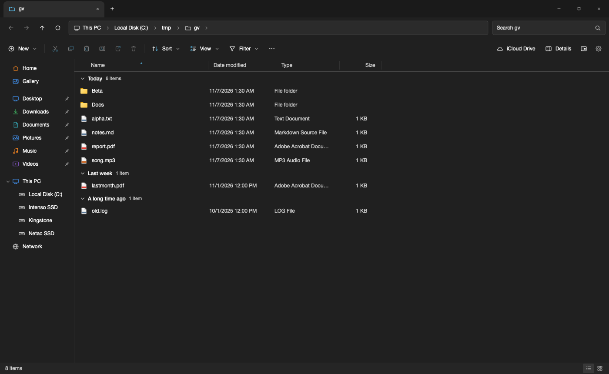

<div align="center">


# File Explorer for Mac

**The Windows 11 File Explorer, rebuilt natively for macOS.**

Same layout, same Fluent iconography, same keyboard shortcuts, driving the real macOS filesystem.

[](https://www.apple.com/macos/)
[](https://swift.org)
[](#build)
[](#tests)
[](https://github.com/Swallow74/windows-explorer-mac/actions/workflows/build.yml)
[](LICENSE)


</div>

## Why

I wanted Windows Explorer on my Mac. Not "a file manager with Windows-ish styling", but the actual thing: the tab strip, the command bar, the breadcrumb address bar, `Ctrl+C` / `Ctrl+V` / `F2` / `Alt+Left`, and the Fluent icons.

So I built it. No Electron, no dependencies, no package manager. One `swiftc` invocation produces a 5 MB native app.

## Highlights

|  |  |
|---|---|
| **Pixel-faithful chrome** | Tab strip with Windows caption buttons drawn where the traffic lights normally go, breadcrumb address bar with sibling drop-downs, command bar, status bar. Colours come from the WinUI 3 dark and light palettes. |
| **Redrawn Fluent icons** | Segoe Fluent Icons isn't licensed onto macOS, so every glyph is redrawn as vector geometry on Windows' own 16pt design grid, including the two-tone accent treatment on cut, copy, paste, rename, share, sort and view. |
| **Real Windows shortcuts** | Bound to both `Ctrl` (Windows) and `Cmd` (Mac reflex), and every one of them re-mappable from Settings. |
| **Eight view modes** | Icon grids with live Quick Look thumbnails, List that flows into columns, Details with sortable resizable columns, Tiles, Content. **Group by** Name, Type, Date modified or Size, with collapsible Windows-style section headers (List, Tiles and Content ignore grouping, as Windows does). |
| **It actually does the work** | Copy, cut and move — same-volume copies are APFS clones, instant and free until modified — paste with `- Copy` naming in the same folder and the Windows "Replace or Skip Files" prompt (replace, skip, keep both) when the destination already has the names, eject for external drives, rename, ZIP, shortcuts, Recycle Bin and permanent delete, all with undo and redo. Drag and drop works inside the app, onto sidebar folders and Quick access tiles, and to and from Finder, with the drop target lighting up as you hover it. Rubber-band selection works from any empty space, additive with `Shift` or `Ctrl`. Clicking an already-selected name again turns it into an edit field, as in Explorer and Finder, while a double-click still opens. |
| **Power tools** | Dual pane, a background transfer queue with progress, archive browsing, batch rename, folder compare and sync, a drop shelf, workspaces, network shares and user-defined commands. Tabs get a right-click menu (duplicate, paste-to-tab, close), and dropping a file onto a tab sends it to that tab's folder without leaving the current one. |

<div align="center">
 
 

</div>

## Download

Grab the latest build from [Releases](https://github.com/gmazaratti/windows-explorer-mac/releases/latest). Universal binary, Apple Silicon and Intel, macOS 14 or newer.

Since 1.3.1 the release is signed with a Developer ID and **notarized by Apple**: unzip, drag to Applications and double-click, nothing to unblock. Releases up to 1.3.0 were only ad-hoc signed; if macOS refuses one of those, use **System Settings > Privacy & Security > Open Anyway**, or clear the quarantine flag:

```bash
xattr -dr com.apple.quarantine "/Applications/File Explorer.app"
```

If you would rather not trust a download at all, build it from source. That takes one command and produces a binary macOS trusts, because it never came from the internet.

## Power tools

Everything below is optional. Turn a feature off and the app is still the Explorer clone it started as.

<div align="center">
 
</div>

**Dual pane** (`Ctrl+U`). Two independent panes, each with its own tabs and history. `Tab` switches, `Ctrl+Shift+U` swaps them, and the overflow menu copies or moves the selection straight to the other pane. Columns drop out as a pane narrows rather than overflowing it.

**Background transfers.** Copies and moves run on a queue with a progress bar in the status bar, a rate and time estimate, and a cancel button. Nothing blocks the window, and a move within one volume is still instant.

**Archive browsing.** Double-click a zip or a tarball and walk into it like a folder. Open a file inside and it is extracted to a scratch folder first. Extract the whole thing, or just the selection, from the command bar. Zip and the tar family are supported, through the system's own `bsdtar`. RAR and 7z are not, because macOS ships no tool for them.

**Batch rename** (`Ctrl+Shift+R`). Find and replace, prefix, suffix, numbering, case, extension, with a live preview and clash detection before anything is touched. It lands on the undo stack as one step.

**Folder compare and sync.** Compare two trees, see what is only on one side and what differs, then copy one way. Defaults to the two panes when they are open.

**Shelf** (`Ctrl+Shift+S`). A staging area that survives navigation: drop files in, go somewhere else, drop them out. Or use Copy here and Move here.

**Workspaces.** Save the tabs open in each pane, the split and the view mode under a name, and restore them later.

**Network shares** (`Ctrl+K`). Connect to SMB, AFP, NFS, FTP and WebDAV, with recent servers remembered. macOS owns the sign-in, so no password is ever typed into File Explorer. SFTP and S3 are not supported, because macOS cannot mount them without a third-party filesystem.

**Commands.** Your own scripts in the context menu, with the selection in the environment (`$FE_SELECTION`, `$FE_NAMES`, `$FE_FIRST`, `$FE_DIR`, `$FE_COUNT`). Managed from Settings, stored in `~/Library/Application Support/File Explorer/commands.json`. Deliberately scripts rather than loadable native code: a plugin that can crash or compromise the app is not a feature.

## Build

Requires the Swift 6 toolchain that ships with Xcode. The Command Line Tools alone are not enough: SwiftUI's `@State` and friends expand through the `SwiftUIMacros` plugin, which only ships inside a full Xcode. No Xcode project, no Node, no Homebrew.

```bash
git clone https://github.com/gmazaratti/windows-explorer-mac.git
cd windows-explorer-mac
./build.sh
open "build/File Explorer.app"
```

`./build.sh --universal` produces an Apple Silicon and Intel binary, which is what the releases ship.

To keep it around:

```bash
cp -R "build/File Explorer.app" /Applications/
```

To update an installed copy after pulling new commits — the installed app does not track the build folder on its own:

```bash
git pull
./build.sh
rm -rf /Applications/"File Explorer.app"
cp -R "build/File Explorer.app" /Applications/
```

> macOS asks permission the first time the app reads Desktop, Documents, Downloads or a removable volume. Until you allow it, those folders list as empty. That is macOS, not the app.

## Keyboard shortcuts

Every shortcut works with **`Ctrl`** (as on Windows) *and* **`Cmd`** (as Mac muscle memory expects). `Alt` means `Option`.

<table>
<tr><td valign="top">

**Clipboard and files**

| Shortcut | Action |
|---|---|
| `Ctrl+C` | Copy |
| `Ctrl+X` | Cut |
| `Ctrl+V` | Paste |
| `Ctrl+Shift+V` | Paste shortcut |
| `Ctrl+Shift+C` | Copy as path |
| `Ctrl+Z` / `Ctrl+Y` | Undo, redo |
| `F2` | Rename |
| Click a selected name again | Rename in place |
| `Delete` | Recycle Bin |
| `Shift+Delete` | Delete permanently |
| `Ctrl+Shift+N` | New folder |
| `Enter` | Open |
| `Alt+Enter` | Properties |

</td><td valign="top">

**Navigation**

| Shortcut | Action |
|---|---|
| `Alt+Left` / `Alt+Right` | Back, forward |
| `Alt+Up` | Up one level |
| `Backspace` | Back |
| `F5` / `Ctrl+R` | Refresh |
| `Ctrl+L` / `Alt+D` / `F4` | Address bar |
| `Ctrl+F` / `F3` | Search |
| `Ctrl+D` | Show desktop (Win+D) |
| `Ctrl+Shift+D` | Go to Desktop folder |
| `Ctrl+Shift+H` | Go Home |
| `Ctrl+Shift+J` | Go to Downloads |
| Type letters | Type-ahead jump |

</td><td valign="top">

**View, tabs and windows**

| Shortcut | Action |
|---|---|
| `Ctrl+Shift+1` to `8` | The eight view modes |
| `Ctrl+Scroll` | Cycle icon sizes |
| `Ctrl+T` / `Ctrl+W` | New tab, close tab |
| `Ctrl+Shift+T` | Reopen the last closed tab |
| `Ctrl+Tab` | Next tab |
| `Ctrl+1` to `9` | Jump to tab |
| `Ctrl+N` | New window |
| `Ctrl+A` | Select all |
| `Alt+P` / `Alt+Shift+P` | Preview, details pane |
| `Ctrl+H` | Hidden items |
| `Ctrl+U` | Dual pane |
| `Tab` | Switch pane |
| `Ctrl+Shift+U` | Swap panes |
| `Ctrl+Shift+R` | Batch rename |
| `Ctrl+Shift+S` | Shelf |
| `Ctrl+K` | Connect to server |
| `Ctrl+,` | Settings |

</td></tr>
</table>

`Ctrl+D` is Windows' `Win+D`: it hides every app so the desktop itself is showing, and puts them back when you press it again.

## Settings


The gear at the right end of the command bar, also in the `...` menu, the background right-click menu, and on `Ctrl+,`.

- **Appearance.** System, Light or Dark, eight accent colours, and toggles for compact view, the three panes, item check boxes, extensions and hidden items.
- **Shortcuts.** Re-map any command. Click a shortcut, press the keys. If the combination is taken it is moved off the other command and you are told which. Per-command and global reset.
- **Quick access.** Everything pinned to the sidebar. Unpin any of it, including the six Windows defaults, restore what you unpinned, add folders.
- **Folder icons.** The folders you have customised, with a reset for each.

**Pinning.** Right-click any folder, in the list or the sidebar, then choose *Pin to Quick access*.

**Custom folder icons.** Right-click a folder and choose *Change icon*, then pick a Fluent glyph and a colour, or tint the standard folder. It applies in the file list, the sidebar and the Home tiles.

<br clear="right">

## How the icons were made

Windows draws its command bar with **Segoe Fluent Icons**, a font that ships with Windows and isn't available on macOS. Copying the font wasn't an option, so the glyphs are reconstructed instead.

Each icon is authored as a string in a small path language, on the same 16x16 grid Fluent uses:

```swift
.paste:  ("R 3.4 3.0 9.2 10.6 1.5 M6.2 3.0 V2.4 C6.2 1.9 6.5 1.6 7 1.6 H9 C9.5 1.6 9.8 1.9 9.8 2.4 V3.0", "")
.filter: ("M2.4 3.4 H13.6 L9.2 8.6 V13.4 L6.8 11.8 V8.6 Z", "")
```

`M/L/H/V/C/Q/Z` are the usual SVG commands, `O` adds a circle, `R` a rounded rect, `K` an arc. A parser of about 60 lines turns them into SwiftUI `Path`s rendered in a `Canvas`. A second, optional layer per icon carries the accent-coloured part: the blue rings on the scissors, the blue sheet inside the clipboard. That layer is what makes the command bar read as Windows rather than as generic line art.

The palette was taken from the WinUI 3 design tokens and cross-checked by sampling pixels out of a real Windows 11 screenshot.

## Architecture

```
Sources/
  Theme.swift          WinUI 3 colour system, metrics, type ramp
  Glyphs.swift         Fluent icon set: path mini-language and renderer
  FileIcons.swift      Folder and file-type artwork, Quick Look thumbnails
  Model.swift          FileItem, Windows metadata formatting, known folders
  Explorer.swift       Tabs, history, selection, clipboard, file ops, undo, search
  Grouping.swift       The "Group by" buckets and their Windows labels
  Settings.swift       Re-mappable shortcuts, theme, folder icons, pinning
  WindowModel.swift    One or two panes per window
  Transfers.swift      Background copy and move queue with progress
  Updater.swift        Update check against GitHub Releases and self-update
  Archives.swift       Reading and extracting zip and tar archives
  BatchRename.swift    The rename rule and its dialog
  CompareSync.swift    Folder comparison and one-way sync
  RemoteServers.swift  Network shares, mounted by macOS itself
  Workspaces.swift     Saved pane and tab layouts
  Shelf.swift          The staging area
  Marquee.swift        Rubber-band selection
  CustomCommands.swift User-defined scripts in the context menu
  Controls.swift       Win11 buttons, flyout menus, AppKit-backed text fields
  Chrome.swift         Title bar, address bar, command bar
  Sidebar.swift        Navigation pane and drop handling
  FileList.swift       Details, icons, list, tiles, content, right-click routing
  HomeView.swift       Quick access and Recent
  Panes.swift          Status bar, details pane, preview pane
  Dialogs.swift        Properties, delete confirmation, errors
  SettingsDialog.swift Settings and folder-icon dialogs
  ContextMenus.swift   Right-click menus
  ContentView.swift    Root layout, flyout and dialog hosting
  App.swift            Window setup, key bindings, menu bar
  main.swift           The executable's entry point
  SelfTest.swift       End-to-end checks
  Demo.swift           The scripted tour behind the README animation
Tools/
  MakeIcon.swift       Draws the app icon, one render per icon-set size
  release.sh           Signs, notarizes and staples a release build
  package.sh           Zips the release with its install instructions
build.sh               Compiles and assembles the .app bundle
```

Two decisions worth calling out:

- **Right-click routing.** Context-menu targets register an invisible marker view, and a window-level monitor picks the smallest target under the pointer, falling back to the file-area background. Fighting AppKit's hit-testing instead would have swallowed the left clicks SwiftUI needs for selection and drag and drop.
- **Rubber-band selection is routed the same way.** A SwiftUI drag gesture on the list background never fires, because the enclosing ScrollView claims drags for scrolling first. A window-level monitor takes the press only when it lands on empty space inside a pane, so a drag that starts on an item still drags the item.
- **Shortcuts match on key code, not character.** `Shift+3` reports `#`, not `3`, so matching on characters silently breaks every `Ctrl+Shift+<digit>` binding.

## Tests

```bash
WINEXP_SELFTEST=1 "build/File Explorer.app/Contents/MacOS/FileExplorer"
```

Creates a scratch folder and drives the **real** key handler and file operations through copy, cut, paste, undo, rename (including the second-click rename), delete, restore, navigation, tabs, view modes, type-ahead, sorting, grouping and section folding, search, shortcut re-mapping, pinning, folder icons, right-click routing and the safety of archive extraction against crafted entry names. **118 checks.** The suite is deterministic: it never depends on the order background transfers land in.

GitHub Actions runs the build, the signature check and this suite on every push (`.github/workflows/build.yml`), and uploads the universal app as a workflow artifact.

Development helpers: `WINEXP_START=<path>` opens at a folder, `WINEXP_SNAPSHOT=<file.png>` writes a screenshot of the window, `WINEXP_SIZE=1400x900` opens at a given size, `WINEXP_TEST=menu:context|dialog:settings|dialog:about|dual|dual-home|rename|archive|compare|marquee|drop` opens a particular menu, dialog or layout for inspection, and `WINEXP_DEMO=<dir>` drives the scripted tour that produces the animation at the top of this page.

## Deliberate differences

- **Extensions are shown by default.** Windows hides known ones. The toggle is in `View > Show > File name extensions`.
- **The Recycle Bin is the macOS Trash**, so deleted items land where the rest of the system expects them.
- **Drives.** The boot volume is labelled `Local Disk (C:)`, and other mounted volumes appear under This PC by their own names.
- **"Account disconnected"** reports what is actually on the Mac. It reads *iCloud Drive* or *OneDrive* when either is present, and *Account disconnected* when neither is.
- Archive browsing is read-only. Dropping files into a zip is not supported.
- **Undo history is per pane.** Each pane undoes its own operations; Windows keeps one history per window.
- **A dragged selection carries the item under the pointer.** Windows drags the whole selection.

## Changes in this fork

Fork of [gmazaratti/windows-explorer-mac](https://github.com/gmazaratti/windows-explorer-mac), maintained by [Alessandro Del Rosso](https://github.com/Swallow74). Everything below was added on top of the original 1.0 code base.

**File operations**
- **Replace or Skip Files** dialog, as in Windows: replace, skip or keep both when the destination already has the names.
- **Progress dialog** modelled on the Windows 11 copy window: percentage, live speed graph, name, time left and item count.
- **APFS clones** for same-volume copies: instant at any size, free until modified. exFAT and network mounts fall back to the byte copy.
- **Eject** for external drives and network shares, from the context menu and the sidebar.
- Safer transfers: a failed cross-volume move records its orphaned copy so undo can remove it, same-volume moves advance the bar per item, cancel no longer stalls the main thread, copy collisions always get the `- Copy` suffix.
- Undo and redo are honest: per-item failures are reported, only what really reverted is redoable, undoing *New folder* restores the same items, and every tab showing a touched folder refreshes.
- **Hostile archives refused.** A zip with a member named `-P` could write outside the extraction folder; entry names are now passed to `bsdtar` after `--`, and a folder copied into itself is rejected.

**Navigation and views**
- **Group by** is real: Name, Type, Date modified (Today, Yesterday, Earlier this week, and so on) and Size (Tiny to Gigantic), with collapsible section headers in Details, as in Explorer. Arrow keys follow the on-screen order, including folded groups.
- **Navigation pane follows you**: the folder tree expands on its own down the path you are viewing, and is cached so it does not flicker or rescan.
- **User folders resolved through the system**: Desktop, Documents and the others still work when they have been moved or are symlinks.
- Home and This PC watch `/Volumes`, so an unplugged drive disappears instead of lingering.
- **Tabs**: right-click menu (duplicate, paste into tab, close), drop files onto a tab to land them in its folder, `Ctrl+Shift+T` reopens the last closed tab, a closed tab before the active one no longer changes the selection.
- `Ctrl+Scroll` zooms icons in discrete steps instead of a continuous, jumpy scale.

**Selection and input**
- `Shift`/`Ctrl`/`Cmd`+click uses the modifiers held **at press time**, so a quick click-and-release no longer collapses a multi-selection.
- Rubber-band selection no longer swallows clicks on open menus, and picks the right window when two Explorers are open.
- Inline rename commits on focus loss; case-only renames work on case-insensitive APFS; shortcut re-mapping detects real conflicts.
- Column, pane-divider and details-pane resize track the pointer 1:1 (they used to compound).

**Updates and distribution**
- **Update notification**: the app checks the GitHub Releases of the fork at launch (at most once a day) and from the app menu, and lets you skip a version.
- **One-click self-update**: it downloads the release, verifies it, replaces the installed app and reopens it. If that is not possible it opens the download page instead. A fork can point the check elsewhere with the `FEUpdateRepo` key in `Info.plist`.
- **Notarized releases** from 1.3.1: Developer ID signature, `Tools/release.sh` signs, notarizes and staples, `Tools/package.sh` builds the zip.
- `build.sh` builds for the host architecture by default (`--universal` for both), checks that `swiftc` exists, and passes `FE_VERSION` to the bundle so the About panel shows the real version.
- **CI** on GitHub Actions: universal build, signature check, self-test, app uploaded as an artifact; one queued build per branch.
- The README now says plainly that building needs a full Xcode, not just the Command Line Tools.

**Tests**
- The self-test suite grew from 49 to more than 118 checks, covering grouping, modifier capture at press time, hostile archive names, self-copy refusal and the tab and transfer paths.

Ideas and behaviours borrowed from other open-source Mac explorers (MacXplorer, MaXplorer, MacExplorer, explorer-macos) were **reimplemented from scratch**; no code from GPL projects is included.

## Credits

**Created by [Alex Degryse](https://www.linkedin.com/in/alexdegryse)**, [linkedin.com/in/alexdegryse](https://www.linkedin.com/in/alexdegryse) and [github.com/gmazaratti](https://github.com/gmazaratti)

**Fork and modifications by [Alessandro Del Rosso](https://github.com/Swallow74)**

Not affiliated with or endorsed by Microsoft. Windows, Windows 11, File Explorer, Segoe and Fluent are trademarks of Microsoft Corporation. All artwork in this project is original: the app icon is drawn from scratch by `Tools/MakeIcon.swift`, and the in-app iconography is original vector work laid out on Fluent's design grid.

## License

[Apache License 2.0](LICENSE).

- Copyright 2026 Alex Degryse (original work).
- Modifications copyright 2026 Alessandro Del Rosso (this fork, see [Changes in this fork](#changes-in-this-fork)).

You are free to use, modify and redistribute it, including commercially. In
return the licence requires that the [NOTICE](NOTICE) file travels with any copy
or derivative you distribute, which credits Alex Degryse and links back to the
original repository. If you ship it inside an app, that notice belongs in your
acknowledgements screen.
